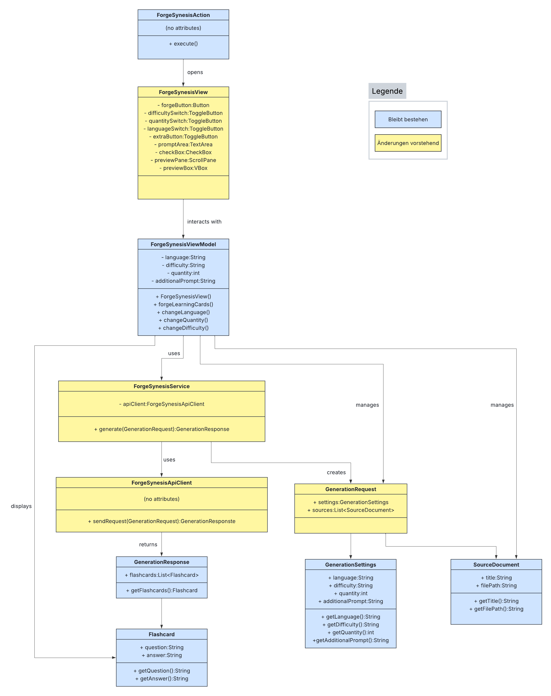
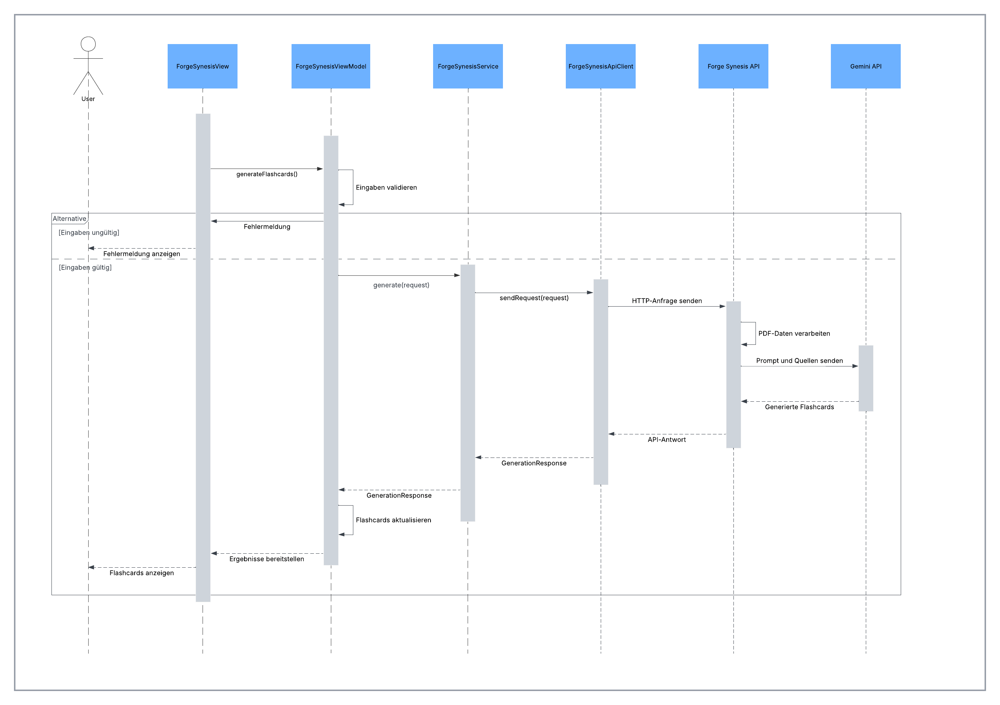
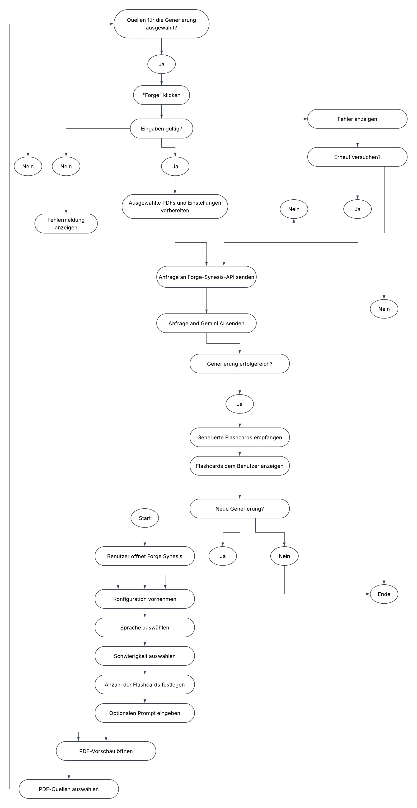
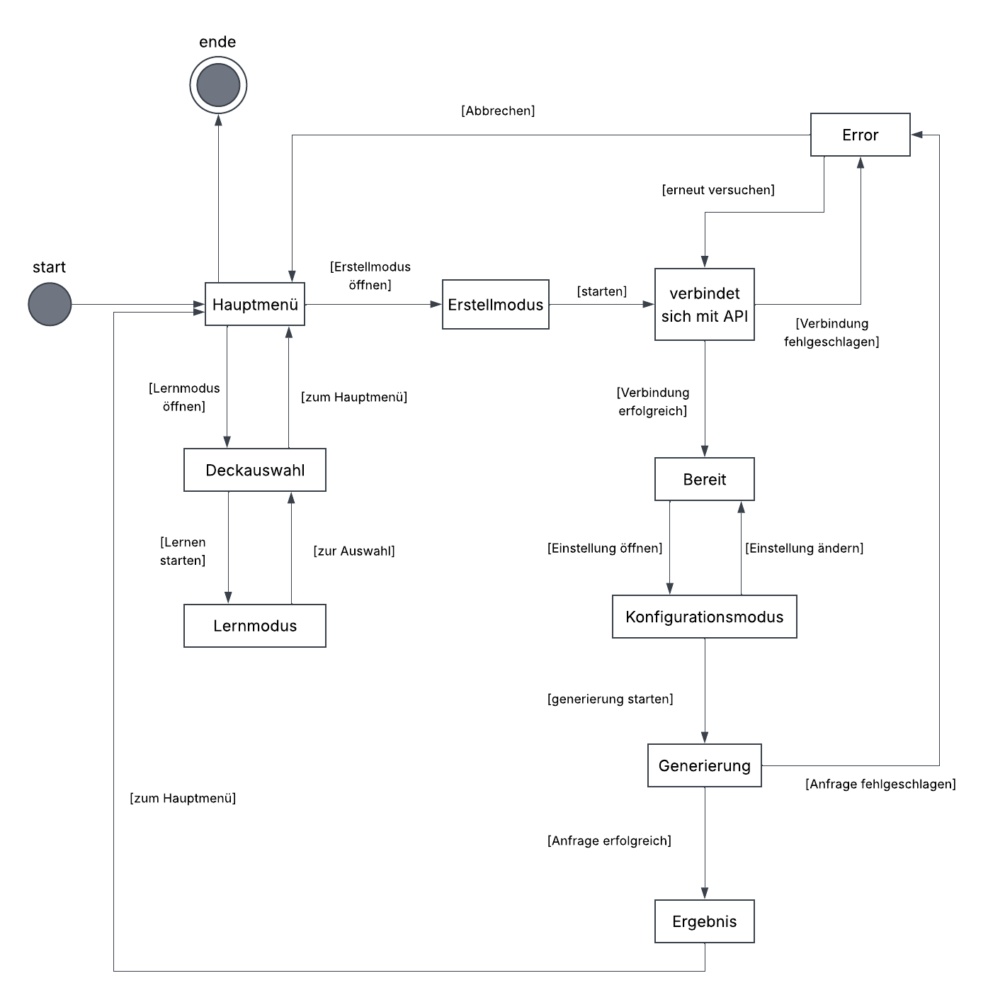

# Technische Dokumentation

| Version | Projektname   | Autor                                                                        | Status | Datum      | Kommentar                                                                                                                                                                        |
|---------|---------------|------------------------------------------------------------------------------|--------|------------|----------------------------------------------------------------------------------------------------------------------------------------------------------------------------------|
| 0.1     | Forge Synesis | Jasra Mohamed Yousaf  Bavan Sivaloganathan  Erind Shima  Shahriar Sheak | Fertig | 30.10.2026 |                                                                                                                                                                                  |
| 0.2     | Forge Synesis | Shahriar Sheak | Fertig | 10.11.2026 | Zustandsdiagramm und verbesserte Klassen- und Aktivitätsdiagramme hinzugefügt. Eintrag zu Statik beigefügt. Pflichtenheft.md referenziert (link funktioniert nach merge) |

# 1 Einführung

# 1.1 Zweck

Diese technische Dokumentation beschreibt den Aufbau und die geplante Funktionsweise der JabRef-Erweiterung „Forge Synesis“. Dabei werden die grundlegenden Designentscheidungen erläutert und die vorgesehenen Funktionen sowie die Struktur des Systems dargestellt. Ausserdem wird beschrieben, wie die einzelnen Komponenten miteinander kommunizieren und wie die Interaktion zwischen dem User und der Erweiterung abläuft.

Das Dokument soll einerseits sicherstellen, dass Auftraggeber und Entwickler ein gemeinsames Verständnis der geplanten Umsetzung haben. Andererseits dient es während der Entwicklung als Orientierung und technische Grundlage für die Implementierung.

# 1.2 Beziehung zu anderen Dokumenten

| Dokument                        | Beschreibung                                                                | Link                                  |
|---------------------------------|-----------------------------------------------------------------------------|---------------------------------------|
| JabRef Documentation            | Dokumentation der Literaturverwaltungssoftware JabRef und ihrer Funktionen  | https://docs.jabref.org/              |
| Google Gemini API Documentation | Dokumentation der Gemini API zur KI-gestützten Generierung von Lernkarten   | https://ai.google.dev/gemini-api/docs |
| Java Documentation              | Offizielle Dokumentation der Programmiersprache Java und ihrer Bibliotheken | https://docs.oracle.com/en/java/      |
| Markdown Guide                  | Referenz für die Formatierung der Projektdokumentation in Markdown          | https://www.markdownguide.org/        |
| Pflichtenheft                   | Referenz für das Pflichtenheft                                              | [Pflichtenheft](./Pflichtenheft.md)   |

# 2. Systemübersicht

„Forge Synesis“ ist eine Erweiterung für das Literaturverwaltungsprogramm JabRef. Ziel des Projekts ist es, Studierende bei der Erstellung von Lernmaterialien zu unterstützen. Obwohl JabRef bereits die Verwaltung wissenschaftlicher Quellen und deren zugehörigen PDF-Dateien ermöglicht, bietet es selbst keine direkte Möglichkeit, daraus automatisch Lernkarten zu erstellen. Die Erweiterung soll diese Lücke schliessen.

Hierfür erhält der User die Möglichkeit, PDF-Dokumente aus seiner JabRef-Bibliothek auszuwählen und für die Generierung von Lernkarten zu verwenden. Vor dem Start können verschiedene Parameter wie Sprache, Schwierigkeitsgrad und gewünschte Anzahl der Karten festgelegt werden. Darüber hinaus besteht die Möglichkeit, durch einen eigenen Prompt zusätzliche Anweisungen für die Generierung zu formulieren.

Die Verarbeitung der ausgewählten Dokumente erfolgt über eine eigens vorgesehene API-Schnittstelle. Diese übernimmt die Kommunikation mit einem externen KI-Modell, welches auf Basis der bereitgestellten Quellen und Einstellungen geeignete Lernkarten erstellt. Das Ergebnis wird anschliessend an die Erweiterung zurückgegeben und dem User zur Verfügung gestellt.

# 3. Designziele

* Die Benutzeroberfläche soll sich optisch und funktional in JabRef einfügen.

* Die Bedienung soll möglichst verständlich und ohne umfangreiche Vorkenntnisse möglich sein.

* Die Softwarestruktur soll zukünftige Erweiterungen und zusätzliche Funktionen unterstützen.

* Die einzelnen Systemkomponenten sollen klar voneinander getrennt sein, um Änderungen zu erleichtern.

* Die Kommunikation mit externen Diensten soll zuverlässig und wartbar gestaltet werden.

# 4. Systemverhalten

Beim Öffnen von Forge Synesis erscheint ein separates Fenster innerhalb von JabRef. Dieses stellt die verschiedenen Einstellungsmöglichkeiten bereit, über welche der User die Erstellung seiner Lernkarten konfigurieren kann.

Zunächst können die in JabRef gespeicherten PDF-Dokumente in einer Vorschau angezeigt und einzeln ausgewählt werden. Anschliessend lassen sich die gewünschten Generierungsparameter festlegen. Dazu gehören insbesondere die Sprache, der Schwierigkeitsgrad und die Anzahl der zu erstellenden Lernkarten. Ein zusätzliches Eingabefeld ermöglicht es, eigene Anweisungen in Form eines Prompts hinzuzufügen.

Sobald der User die Generierung startet, werden die ausgewählten Dokumente und die festgelegten Einstellungen an die Forge-Synesis-API weitergegeben. Diese verarbeitet die Anfrage und nutzt ein externes KI-Modell, um passende Lernkarten aus den bereitgestellten Inhalten zu erstellen. Nach erfolgreicher Verarbeitung werden die Ergebnisse zurück an die Erweiterung übermittelt und dem User angezeigt.
# 5. Design

## 5.1 Statik

Die Funktionalität von Forge Synesis wird durch mehrere Klassen innerhalb des Packages org.jabref.gui.forgesynesis umgesetzt. Die Einstiegsklasse zum Öffnen der Anwendung ist ForgeSynesisAction, welche das Forge-Synesis-Fenster innerhalb von JabRef aufruft.

Die Klasse ForgeSynesisView ist für die Darstellung der Benutzeroberfläche verantwortlich. Sie enthält sämtliche UI-Elemente, darunter die Parameterschalter sowie die Eingabe- und Anzeigefelder. Die Klasse ForgeSynesisViewModel kapselt die zugrunde liegenden Funktionen und verwaltet die für die Benutzeroberfläche benötigte Logik und Daten.

Die Klasse ForgeSynesisApiClient stellt die Schnittstelle zur externen API bereit. ForgeSynesisService übernimmt die Verwaltung und Verwendung dieses API-Clients und koordiniert die Kommunikation mit dem externen Dienst.

Die Klassen GenerationsResponse und Flashcard dienen als Datenmodelle für die Flashcard-Generierung. Sie repräsentieren die API-Antwort beziehungsweise die darin enthaltenen Flashcards und werden zur Speicherung und Weiterverarbeitung der generierten Ergebnisse verwendet.

Die Klasse GenerationRequest repräsentiert die Anfrage zur Flashcard-Generierung. Sie setzt sich aus den Objekten GenerationSettings und SourceDocument zusammen, welche die gewählten Generierungsparameter beziehungsweise die Quelldokumente enthalten. ForgeSynesisService verwendet diese Anfrage, um die Flashcard-Generierung über die API anzustoßen.

## 5.2 Dynamik

Der typische Ablauf für die Generierung von Flashcards ist anhand folgenden Diagrammen dargestellt. 

## 5.3 Logik

Die Funktionsweise von Forge Synesis basiert auf verschiedenen logischen Bedingungen, welche einen korrekten Ablauf der Lernkartengenerierung sicherstellen sollen.

* Dokumentenauswahl: Für die Generierung müssen mindestens ein PDF-Dokument ausgewählt und dessen Inhalt erfolgreich verarbeitet werden können.

* Eingabevalidierung: Die erforderlichen Einstellungen müssen vor dem Start der Generierung überprüft werden. Dazu gehören insbesondere die Anzahl der gewünschten Lernkarten sowie die ausgewählten Parameter.
